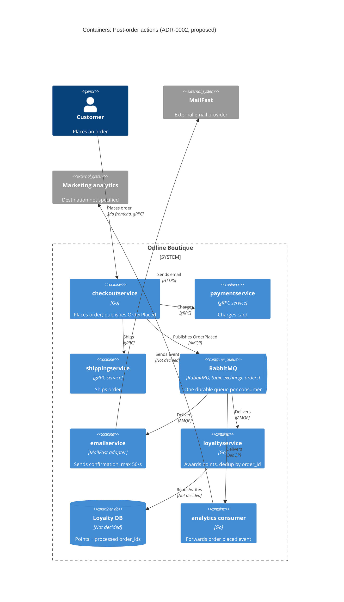

> Agent: Claude Code — model: Claude Opus 5.5 (`claude-opus-5-5`) · Task 2, run `b` (with context) · language: Thai

# ADR-0002: Publish an "OrderPlaced" event to RabbitMQ for post-order actions

- **Status:** Proposed
- **Date:** 2026-10-31
- **Deciders:** ทีมพัฒนา Online Boutique (4 คน — ยังไม่ระบุรายชื่อ ดู Open questions)

## Context and problem

Requirement R-12 (`docs/scenario.md`) กำหนดว่าหลังจากสั่งซื้อสำเร็จ ระบบต้อง (1) ส่งอีเมลยืนยันผ่าน **MailFast** แทน logic mock ของ `emailservice` (2) ให้ **loyalty points** ผ่าน `loyaltyservice` ตัวใหม่ (3) บันทึก **analytics event "order placed"** ให้ทีม marketing และปีหน้าจะมี post-order action เพิ่มอีก (SMS, fraud scoring, recommendations update)

**ระบบทุกวันนี้** (evidenced):

- `checkoutservice.PlaceOrder` เรียก service อื่นแบบ **synchronous gRPC ทีละตัวตามลำดับ**: `chargeCard` → `shipOrder` → `emptyUserCart` → `sendOrderConfirmation` (`system/online-boutique/src/checkoutservice/main.go`, `PlaceOrder` บรรทัด 230–280)
- ถ้าส่งอีเมลไม่สำเร็จ checkout แค่ `log.Warnf` แล้วคืนผลสำเร็จต่อไป (`main.go` บรรทัด 273–277) และ error จาก `emptyUserCart` ถูกทิ้งไปเลย (`_ = cs.emptyUserCart(...)` บรรทัด 263)
- ทุก dependency ถูกต่อแบบตายตัวผ่าน environment variable และ `grpc.ClientConn` แยกของแต่ละตัว (`checkoutService` struct บรรทัด 66–86, `mustMapEnv` บรรทัด 111–116) การเพิ่ม action ใหม่จึงต้องแก้โค้ดและ deploy `checkoutservice` ใหม่ทุกครั้ง
- `orderID` สร้างด้วย `uuid.NewUUID()` ก่อนตัดเงิน (`main.go` บรรทัด 233) จึงใช้เป็น idempotency key ได้
- `checkoutservice` ไม่มี database ของตัวเอง (`main.go` ไม่มี datastore client ใดๆ มีแต่ gRPC connections)

**ตัวเลขที่บังคับการตัดสินใจ** (`docs/scenario.md`, *Quality goals and constraints*):

| ประเด็น | ข้อเท็จจริง | ผลต่อการออกแบบ |
|---|---|---|
| Checkout latency | p95 ของ `PlaceOrder` ≤ **500 ms** (ปัจจุบันประมาณ 300 ms) | เหลืองบเพิ่มได้ประมาณ **200 ms** เท่านั้น |
| MailFast | p95 **1.5 s**, p99 **8 s**, ล้มเหลวประมาณ **0.5 %**, rate limit **50 emails/s** | ถ้าเรียกแบบ sync, p95 ของ MailFast อย่างเดียว (1.5 s) ก็เกินงบ 500 ms แล้ว |
| Peak load | **200 orders/s** ช่วง 11.11 | มากกว่า rate limit ของ MailFast **4 เท่า** → ต้องมีที่พักงาน (buffer) และคุมอัตราการส่ง |
| Loyalty points | ภายใน **1 นาที**, **exactly once** | ต้องมี retry + การกันซ้ำ (deduplication) |
| Availability | order **ห้ามล้มเหลว** เพราะ email, loyalty หรือ analytics ล่ม | งานหลัง order ต้องแยกออกจาก critical path |
| Team | 4 คน ถนัด Go และ gRPC, **2 คนเคยใช้ RabbitMQ** | |
| Operations | รันบน Kubernetes ทั้งหมด, เลือก **open-source, self-hosted** ก่อน managed cloud service | |

**ปัญหาที่ต้องตัดสินใจ:** `checkoutservice` ควรสั่งงานหลัง order อย่างไร ให้ latency อยู่ในงบ, order ไม่ล้มเพราะ downstream, loyalty ได้ exactly once ภายใน 1 นาที และเพิ่ม action ใหม่ได้โดยไม่ต้องแก้ checkout

## Decision drivers

1. **Availability:** order ต้องไม่ล้มเหลวเพราะ MailFast, `loyaltyservice` หรือ analytics ล่ม
2. **Performance:** p95 ของ `PlaceOrder` ≤ 500 ms ที่ 200 orders/s
3. **Reliability / correctness:** ให้ loyalty points แค่ครั้งเดียวต่อ order ภายใน 1 นาที และส่งอีเมลได้แม้ MailFast ล้มเหลว 0.5 % ของการเรียก
4. **Modifiability:** เพิ่ม post-order action ใหม่ (SMS, fraud scoring, recommendations) ได้โดยไม่ต้องแก้ `checkoutservice`
5. **Rate-limit compliance:** ส่งไป MailFast ไม่เกิน 50 emails/s แม้ order จะเข้ามาที่ 200/s
6. **Operability และทักษะทีม:** open-source, self-hosted บน Kubernetes, ทีม 4 คนดูแลได้

## Considered options

1. **Synchronous fan-out:** ขยายแนวทางเดิม ให้ `PlaceOrder` เรียก MailFast adapter, `loyaltyservice` และ analytics ผ่าน gRPC ตามลำดับ
2. **In-process async:** `PlaceOrder` ตอบกลับทันที แล้วสั่งงานทั้งสามใน goroutine ภายใน `checkoutservice` (fire-and-forget พร้อม retry ใน memory)
3. **Event-driven ด้วย RabbitMQ:** `checkoutservice` publish event `OrderPlaced` ไปที่ topic exchange เดียว แต่ละ consumer (`emailservice`/MailFast, `loyaltyservice`, analytics) มี queue ของตัวเอง
4. **Event-driven ด้วย Apache Kafka:** เหมือนข้อ 3 แต่ใช้ Kafka topic และ consumer group

### Pros and cons of the options

| Option | Pros | Cons |
|---|---|---|
| 1. Synchronous fan-out | ง่ายที่สุด ใช้ gRPC ที่ทีมถนัด; ไม่มี component ใหม่; รู้ผลทันที | p95 ของ MailFast (1.5 s) อย่างเดียวก็เกินงบ 500 ms; p99 8 s ทำให้ request ค้าง; ที่ 200 orders/s จะชน rate limit 50/s; retry ทำได้แค่ใน request; ทุก action ใหม่ต้องแก้และ deploy `checkoutservice` |
| 2. In-process async | latency ของ checkout แทบไม่เพิ่ม; ไม่มี infrastructure ใหม่ | งานหายถ้า pod restart หรือ crash (ไม่มี durability) จึงรับประกัน loyalty exactly once ไม่ได้; backlog อีเมลที่ 200/s เทียบกับ 50/s ไปค้างอยู่ใน memory ของ checkout; ยังผูก action ทุกตัวไว้กับโค้ด checkout (modifiability ต่ำ) |
| 3. RabbitMQ | แยก action ออกจาก critical path; queue แบบ durable ช่วยพักงานช่วง peak และคุม consumer ไม่ให้เกิน 50 emails/s; retry/dead-letter queue มีมาในตัว; เพิ่ม action ใหม่แค่ bind queue ใหม่เข้ากับ exchange; open-source, self-hosted บน Kubernetes ได้; **2 ใน 4 คนเคยใช้** | ต้องดูแล stateful component ใหม่ (cluster, storage, monitoring); delivery เป็นแบบ at-least-once จึงต้องทำ idempotency ที่ consumer เอง; เป็น eventual consistency (อีเมล/แต้มมาทีหลัง); publish แล้ว broker ล่มต้องมีวิธีจัดการ |
| 4. Kafka | throughput สูงมาก; เก็บ event log ไว้ replay ได้ (เหมาะกับ analytics); open-source, self-hosted ได้ | ดูแลบน Kubernetes ยากกว่า (partition, retention, rebalancing); **ไม่มีใครในทีมเคยใช้** (ไม่ได้ระบุใน scenario); ไม่มี delayed retry หรือ per-message dead-letter ในตัว ต้องสร้างเอง; 200 events/s ไม่จำเป็นต้องใช้ความสามารถระดับ Kafka |

## Decision

เลือก **Option 3: event-driven ด้วย RabbitMQ** (self-hosted ใน cluster Kubernetes เดิม)

1. หลัง `shipOrder` สำเร็จ `checkoutservice` จะ **publish event `OrderPlaced`** หนึ่งครั้ง (มี `order_id` จาก `uuid.NewUUID()` เป็น message ID / idempotency key, email, รายการสินค้า, ยอดรวม) ไปที่ topic exchange `orders` โดยเปิด **publisher confirms** และตั้ง timeout สั้นๆ แทนการเรียก `sendOrderConfirmation` แบบ sync (`main.go` บรรทัด 273)
2. ถ้า publish ไม่สำเร็จ (broker ล่ม/timeout) checkout **ยังคืน order สำเร็จ** (คงพฤติกรรมเดิมที่บรรทัด 273–277) แล้วบันทึก error และ metric ไว้ วิธีกู้ event ที่หายในกรณีนี้ (เช่น transactional outbox) ยังเปิดอยู่ ดู Open questions
3. แต่ละ consumer มี **durable queue ของตัวเอง** ผูกกับ exchange `orders`:
   - `emailservice` (เขียนใหม่ให้เรียก MailFast) — จำกัด consumer rate ไม่เกิน **50 emails/s**, retry แบบ exponential backoff สำหรับ 0.5 % ที่ล้มเหลว แล้วส่งเข้า dead-letter queue เมื่อ retry ครบ
   - `loyaltyservice` (ใหม่, Go) — ใช้ **idempotent consumer**: บันทึก `order_id` ที่ประมวลผลแล้วใน transaction เดียวกับการเพิ่มแต้ม ทำให้ at-least-once delivery กลายเป็นผลแบบ exactly once; queue แยกจากอีเมล จึงไม่โดน backlog ของ MailFast ถ่วงและอยู่ในกรอบ 1 นาทีได้
   - analytics consumer — ส่ง event ต่อไปยังปลายทางของทีม marketing (ปลายทางยังไม่ระบุ)
4. Post-order action ในอนาคต (SMS, fraud scoring, recommendations) = **consumer + queue ใหม่** ไม่ต้องแก้ `checkoutservice`

**เหตุผล:** เป็นตัวเลือกเดียวที่ผ่าน driver 1–5 พร้อม

กัน — Option 1 ตก driver 1, 2, 5 ด้วยตัวเลขของ MailFast; Option 2 ตก driver 3 เพราะงานหายเมื่อ pod restart; ระหว่าง RabbitMQ กับ Kafka, RabbitMQ ตรงกับ driver 6 มากกว่า (ทีมมีประสบการณ์ 2 คน, ฟีเจอร์ retry/DLQ/rate control ในตัว, ปริมาณ 200 msg/s อยู่ในขีดความสามารถ [Inferred — ต้องยืนยันด้วย load test])

## Consequences

- **Positive:** การเรียก MailFast (p95 1.5 s, p99 8 s) ออกจาก critical path เหลือแค่การ publish หนึ่งครั้ง จึงน่าจะอยู่ในงบ 500 ms ได้ (quality attribute: performance) — [Inferred] ยังไม่มีตัวเลข latency ของการ publish
- **Positive:** MailFast, `loyaltyservice` หรือ analytics ล่ม ไม่ทำให้ order ล้ม; งานรออยู่ใน queue จนกว่า consumer จะกลับมา (quality attribute: availability)
- **Positive:** queue พักงานช่วง 11.11 (200/s เข้า, 50/s ออกไป MailFast) จึงไม่ละเมิด rate limit; retry + DLQ รับมือ 0.5 % ที่ล้มเหลว (quality attribute: reliability)
- **Positive:** เพิ่ม action ใหม่ได้โดยไม่ต้องแก้หรือ deploy `checkoutservice` ใหม่ ตัด dependency `EMAIL_SERVICE_ADDR` ออกจาก checkout (quality attribute: modifiability)
- **Negative:** อีเมลอาจมาช้า: ถ้าช่วง peak 200 orders/s ยาว T วินาที backlog จะโตประมาณ 150 × T ข้อความ และใช้เวลาระบายประมาณ 3 × T วินาทีหลัง peak (เช่น peak 10 นาที → ช้าได้ถึงประมาณ 30 นาที) (quality attribute: performance / user experience)
- **Negative:** มี stateful component ใหม่ที่ทีม 4 คนต้องดูแล (deploy, persistence, upgrade, monitoring) (quality attribute: operability / cost)
- **Negative:** เป็น eventual consistency และ debug ยากขึ้น เพราะ flow ข้าม queue (quality attribute: testability / observability) — ต้องส่ง trace context ใน message header ต่อจาก OpenTelemetry ที่ checkout ใช้อยู่ (`main.go` บรรทัด 134–140)
- **Risks and mitigations:**
  - *RabbitMQ เป็น single point of failure ของงานหลัง order* → รันแบบ cluster 3 nodes ด้วย quorum queues บน persistent volume; checkout ไม่ block order เมื่อ publish ล้มเหลว
  - *Event หายถ้า broker ล่มตอน publish* → ระยะแรกบันทึก log/metric ให้ตามแก้ได้; ถ้ารับไม่ได้ (โดยเฉพาะ loyalty) ให้เพิ่ม transactional outbox ซึ่งต้องมี datastore ให้ checkout (ดู Open questions)
  - *แต้มซ้ำจาก at-least-once delivery* → dedup ด้วย `order_id` ใน transaction เดียวกับการให้แต้มใน `loyaltyservice`
  - *อีเมลซ้ำเมื่อ retry หลัง MailFast timeout* → ส่ง `order_id` เป็น idempotency key ถ้า MailFast รองรับ (ยังไม่ทราบ)
  - *Message มีข้อมูลส่วนบุคคล (email)* → จำกัดสิทธิ์ queue ราย consumer และให้ analytics ได้แค่ field ที่จำเป็น

## Validation

- **Load test** (เช่น Locust `loadgenerator`) ที่ **200 orders/s** โดยจำลอง MailFast ให้มี p95 1.5 s, p99 8 s, ล้มเหลว 0.5 % และ rate limit 50/s → ตรวจว่า p95 ของ `PlaceOrder` ≤ **500 ms**
- **Chaos test:** ปิด `emailservice`, `loyaltyservice`, analytics consumer และ RabbitMQ ทีละตัวระหว่าง load → อัตราการสั่งซื้อสำเร็จต้องไม่ลดลง
- **Metric ใน production:** เวลาจาก order ถึงการให้แต้ม p99 < **60 s**; จำนวนแต้มซ้ำต่อ `order_id` = **0**; จำนวนการเรียก MailFast ต่อวินาที ≤ 50; queue depth และขนาด DLQ; จำนวน publish failure ที่ checkout
- **Review date:** ทบทวน ADR นี้หลังเทศกาล 11.11 ครั้งแรก หรือก่อนเพิ่ม post-order action ตัวแรกของปีหน้า

## Open questions

ข้อมูลต่อไปนี้ไม่ได้ระบุในไฟล์ context จึงไม่ได้สมมติตัวเลขเอง:

1. **ช่วง peak 200 orders/s ยาวนานเท่าไร?** ใช้คำนวณ backlog ของอีเมลและขนาด queue/disk
2. **อีเมลยืนยันต้องถึงลูกค้าภายในกี่นาที?** scenario กำหนดเวลาไว้สำหรับ loyalty (1 นาที) แต่ไม่ได้กำหนดสำหรับอีเมล
3. **ยอมรับให้ event หายได้หรือไม่ ถ้า RabbitMQ ล่มตอน publish?** ถ้าไม่ได้ ต้องใช้ transactional outbox ซึ่ง `checkoutservice` ยังไม่มี datastore — จะใช้ datastore อะไร?
4. **Latency ของการ publish ไป RabbitMQ (พร้อม publisher confirms) ใน cluster นี้เป็นเท่าไร?** ต้องวัดเพื่อยืนยันว่าอยู่ในงบที่เหลือประมาณ 200 ms
5. **MailFast รองรับ idempotency key หรือ deduplication ไหม?** และ 0.5 % ที่ล้มเหลวเป็นแบบ retry ได้ทั้งหมดหรือไม่?
6. **ปลายทางของ analytics event คืออะไร** (warehouse, tool ของ marketing) และต้องการ schema/field อะไร?
7. **`loyaltyservice` จะใช้ datastore อะไร** สำหรับแต้มและตาราง dedup?
8. **ใครดูแล RabbitMQ ใน production** (on-call, backup, upgrade) และมีงบ resource ใน cluster เท่าไร?
9. **ถ้า `shipOrder` ล้มเหลวหลังตัดเงินแล้ว** (`main.go` บรรทัด 258–261) ไม่ควรมี `OrderPlaced` — ยืนยันว่า event นี้หมายถึง "order สำเร็จครบ" เท่านั้นใช่ไหม?
10. **ผู้มีอำนาจตัดสินใจ (Deciders)** ของ ADR นี้คือใคร?
