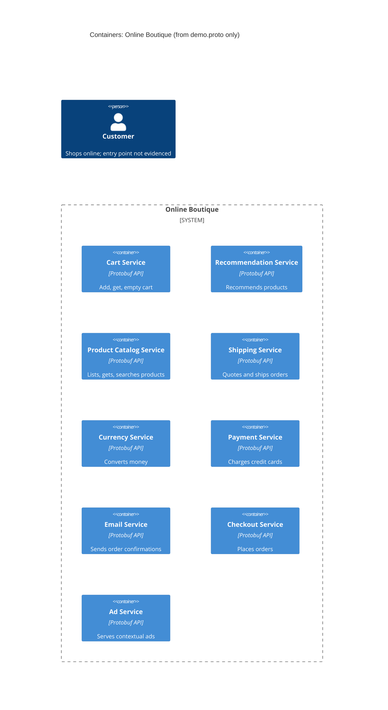

# 1A: Recovered architecture (C4 container level)

## 1. Agent

Claude Code (Anthropic), model Claude Opus 5.5 (`claude-opus-5-5`).

## 2. Files read

- `prompts/1-recover-architecture.md` (task file)
- `system/online-boutique/protos/demo.proto` (only evidence file)

## 3. Containers table

The proto file defines 9 `service` blocks in `package hipstershop` (line 17). It shows each service's API. It does **not** show which language each one is written in, how it is deployed, or whether it is a separate container. One container per `service` is **[Inferred]**.

| Container | Technology / language | Responsibility (from its RPCs) | Evidence |
|---|---|---|---|
| Cart Service | Protobuf API (proto3); language not evidenced | Add item, get cart, empty cart for a `user_id` | `demo.proto` `service CartService` (L23–27) |
| Recommendation Service | Protobuf API; language not evidenced | Recommend product IDs for a user and a list of products | `demo.proto` `service RecommendationService` (L56–58) |
| Product Catalog Service | Protobuf API; language not evidenced | List, get and search products (`Product` with price, categories) | `demo.proto` `service ProductCatalogService` (L71–75) |
| Shipping Service | Protobuf API; language not evidenced | Quote shipping cost; ship order and return `tracking_id` | `demo.proto` `service ShippingService` (L107–110) |
| Currency Service | Protobuf API; language not evidenced | List supported currencies; convert `Money` | `demo.proto` `service CurrencyService` (L140–143) |
| Payment Service | Protobuf API; language not evidenced | Charge a credit card, return `transaction_id` | `demo.proto` `service PaymentService` (L177–179) |
| Email Service | Protobuf API; language not evidenced | Send order confirmation to an email address | `demo.proto` `service EmailService` (L199–201) |
| Checkout Service | Protobuf API; language not evidenced | Place an order (user, currency, address, email, card) and return `OrderResult` | `demo.proto` `service CheckoutService` (L224–226) |
| Ad Service | Protobuf API; language not evidenced | Return ads for page context keywords | `demo.proto` `service AdService` (L243–245) |

Data stores: **Not evidenced in the provided files.** No database, cache or message broker appears in `demo.proto`.

Protocol: every service is a Protobuf `service` with `rpc` methods, which is how gRPC services are defined. That the services actually run over gRPC is **[Inferred]**, because the file only defines the interface, not the transport.

## 4. Dependencies table

| Caller → callee | Protocol | Evidence |
|---|---|---|
| *(none evidenced)* | | `demo.proto` defines server interfaces only. It does not say which service calls which. |

Possible dependencies are listed under **Gaps** because this file does not prove them.

## 5. Mermaid diagram

The diagram has no `Rel` lines because the dependencies table is empty. The `Person` is included because the diagram format requires one. The proto file does not show how the user reaches the system.

## 6. Gaps

| Gap | Hint in `demo.proto` (not proof) | File that would settle it |
|---|---|---|
| Who calls whom | **[Inferred]** `PlaceOrderRequest` (L228–235) carries `Address`, `CreditCardInfo`, `email`, `user_currency`, and `PlaceOrderResponse` returns `OrderResult` with `shipping_tracking_id` (L208–214). So Checkout probably calls Cart, Product Catalog, Currency, Shipping, Payment and Email. | `system/online-boutique/kubernetes-manifests/checkoutservice.yaml` (`*_SERVICE_ADDR` env vars) or the checkout source code |
| Front-end / web UI and how the customer reaches the system | No front-end service is defined. **[Inferred]** Some front end calls Cart, Catalog, Recommendation, Ad, Currency and Checkout. | `system/online-boutique/kubernetes-manifests/frontend.yaml` |
| Transport protocol (gRPC vs. other) | `service` / `rpc` definitions only | Kubernetes manifests (ports, gRPC health probes) or service source code |
| Implementation language of each service | Only `go_package` option (L19), which configures generated Go code. It doesn't say any service is written in Go. | Each service's source folder / Dockerfile under `system/online-boutique/src/` |
| Data stores (e.g. where carts are stored) | None | `system/online-boutique/kubernetes-manifests/cartservice.yaml` and any database/cache manifests |
| External systems (real payment provider, email server) | None. `ChargeRequest` holds raw card data (L181–191), but nothing shows an external call. | Payment and email service source code |
| Whether each `service` is a separately deployed container | None | `system/online-boutique/kubernetes-manifests/` |
