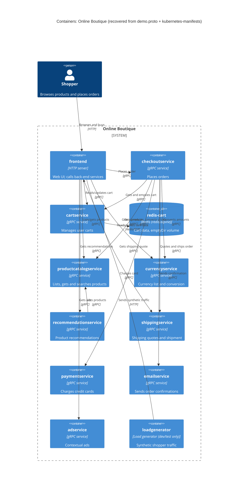

# Task 1 (run B): Recovered C4 container architecture of Online Boutique

## 1. Agent

Claude Code (Anthropic), model Claude Opus 5.5 (`claude-opus-5-5`).

## 2. Files read

- `prompts/1-recover-architecture.md` (task file)
- `system/online-boutique/protos/demo.proto`
- `system/online-boutique/kubernetes-manifests/README.md`
- `system/online-boutique/kubernetes-manifests/kustomization.yaml`
- `system/online-boutique/kubernetes-manifests/adservice.yaml`
- `system/online-boutique/kubernetes-manifests/cartservice.yaml`
- `system/online-boutique/kubernetes-manifests/checkoutservice.yaml`
- `system/online-boutique/kubernetes-manifests/currencyservice.yaml`
- `system/online-boutique/kubernetes-manifests/emailservice.yaml`
- `system/online-boutique/kubernetes-manifests/frontend.yaml`
- `system/online-boutique/kubernetes-manifests/loadgenerator.yaml`
- `system/online-boutique/kubernetes-manifests/paymentservice.yaml`
- `system/online-boutique/kubernetes-manifests/productcatalogservice.yaml`
- `system/online-boutique/kubernetes-manifests/recommendationservice.yaml`
- `system/online-boutique/kubernetes-manifests/shippingservice.yaml`

## 3. Containers table

Implementation language is **not evidenced** in these files: the manifests only give image names (e.g. `image: frontend`), and `demo.proto` is language-neutral. The "Technology" column therefore lists what *is* evidenced: the interface protocol and port.

| Container | Technology / language | Responsibility | Evidence |
|---|---|---|---|
| `frontend` | HTTP server, port 8080 (Service `http` port 80); language not evidenced | Web UI for shoppers; calls the back-end services | `kubernetes-manifests/frontend.yaml` (Deployment `frontend`, `httpGet /_healthz`, Service `frontend-external` type `LoadBalancer`) |
| `cartservice` | gRPC server, port 7070; language not evidenced | Stores and returns a user's cart (`AddItem`, `GetCart`, `EmptyCart`) | `protos/demo.proto` (`service CartService`); `kubernetes-manifests/cartservice.yaml` (Service port name `grpc`, `grpc` probes) |
| `productcatalogservice` | gRPC server, port 3550; language not evidenced | Lists, gets and searches products (`ListProducts`, `GetProduct`, `SearchProducts`) | `protos/demo.proto` (`service ProductCatalogService`); `kubernetes-manifests/productcatalogservice.yaml` |
| `currencyservice` | gRPC server, port 7000; language not evidenced | Lists supported currencies and converts money (`GetSupportedCurrencies`, `Convert`) | `protos/demo.proto` (`service CurrencyService`); `kubernetes-manifests/currencyservice.yaml` |
| `recommendationservice` | gRPC server, port 8080; language not evidenced | Recommends product IDs for a user (`ListRecommendations`) | `protos/demo.proto` (`service RecommendationService`); `kubernetes-manifests/recommendationservice.yaml` |
| `shippingservice` | gRPC server, port 50051; language not evidenced | Quotes shipping cost and ships orders (`GetQuote`, `ShipOrder`) | `protos/demo.proto` (`service ShippingService`); `kubernetes-manifests/shippingservice.yaml` |
| `checkoutservice` | gRPC server, port 5050; language not evidenced | Places an order (`PlaceOrder`) and returns an `OrderResult` | `protos/demo.proto` (`service CheckoutService`); `kubernetes-manifests/checkoutservice.yaml` |
| `paymentservice` | gRPC server, port 50051; language not evidenced | Charges a credit card (`Charge`), returns `transaction_id` | `protos/demo.proto` (`service PaymentService`); `kubernetes-manifests/paymentservice.yaml` |
| `emailservice` | gRPC server, container port 8080 (Service port 5000); language not evidenced | Sends order confirmation (`SendOrderConfirmation`) | `protos/demo.proto` (`service EmailService`); `kubernetes-manifests/emailservice.yaml` (Service `port: 5000`, `targetPort: 8080`) |
| `adservice` | gRPC server, port 9555; language not evidenced | Returns ads for context keywords (`GetAds`) | `protos/demo.proto` (`service AdService`); `kubernetes-manifests/adservice.yaml` |
| `redis-cart` (data store) | Redis (`image: redis:alpine`), port 6379 | Cart data store for `cartservice`; data in an `emptyDir` volume (lost when the pod is removed) | `kubernetes-manifests/cartservice.yaml` (Deployment `redis-cart`, volume `redis-data: emptyDir`) |
| `loadgenerator` (dev/test only) | Language not evidenced | Generates synthetic user traffic against the frontend (`USERS: 10`, `RATE: 1`) | `kubernetes-manifests/loadgenerator.yaml`; commented out in `kubernetes-manifests/kustomization.yaml` ("During development … skaffold.yaml will be used") |

## 4. Dependencies table

Direction comes from the `*_ADDR` environment variables in the **caller's** manifest; the protocol comes from the **callee's** Service port name (`grpc`, `http`, `tcp-redis`) and probe type.

| Caller → Callee | Protocol | Evidence |
|---|---|---|
| Shopper → `frontend` | HTTP (port 80) | `kubernetes-manifests/frontend.yaml` (Service `frontend-external`, `type: LoadBalancer`, port name `http`) |
| `frontend` → `productcatalogservice` | gRPC | `kubernetes-manifests/frontend.yaml` (`PRODUCT_CATALOG_SERVICE_ADDR=productcatalogservice:3550`) |
| `frontend` → `currencyservice` | gRPC | `kubernetes-manifests/frontend.yaml` (`CURRENCY_SERVICE_ADDR=currencyservice:7000`) |
| `frontend` → `cartservice` | gRPC | `kubernetes-manifests/frontend.yaml` (`CART_SERVICE_ADDR=cartservice:7070`) |
| `frontend` → `recommendationservice` | gRPC | `kubernetes-manifests/frontend.yaml` (`RECOMMENDATION_SERVICE_ADDR=recommendationservice:8080`) |
| `frontend` → `shippingservice` | gRPC | `kubernetes-manifests/frontend.yaml` (`SHIPPING_SERVICE_ADDR=shippingservice:50051`) |
| `frontend` → `checkoutservice` | gRPC | `kubernetes-manifests/frontend.yaml` (`CHECKOUT_SERVICE_ADDR=checkoutservice:5050`) |
| `frontend` → `adservice` | gRPC | `kubernetes-manifests/frontend.yaml` (`AD_SERVICE_ADDR=adservice:9555`) |
| `checkoutservice` → `productcatalogservice` | gRPC | `kubernetes-manifests/checkoutservice.yaml` (`PRODUCT_CATALOG_SERVICE_ADDR=productcatalogservice:3550`) |
| `checkoutservice` → `shippingservice` | gRPC | `kubernetes-manifests/checkoutservice.yaml` (`SHIPPING_SERVICE_ADDR=shippingservice:50051`) |
| `checkoutservice` → `paymentservice` | gRPC | `kubernetes-manifests/checkoutservice.yaml` (`PAYMENT_SERVICE_ADDR=paymentservice:50051`) |
| `checkoutservice` → `emailservice` | gRPC | `kubernetes-manifests/checkoutservice.yaml` (`EMAIL_SERVICE_ADDR=emailservice:5000`) |
| `checkoutservice` → `currencyservice` | gRPC | `kubernetes-manifests/checkoutservice.yaml` (`CURRENCY_SERVICE_ADDR=currencyservice:7000`) |
| `checkoutservice` → `cartservice` | gRPC | `kubernetes-manifests/checkoutservice.yaml` (`CART_SERVICE_ADDR=cartservice:7070`) |
| `recommendationservice` → `productcatalogservice` | gRPC | `kubernetes-manifests/recommendationservice.yaml` (`PRODUCT_CATALOG_SERVICE_ADDR=productcatalogservice:3550`) |
| `cartservice` → `redis-cart` | Redis protocol over TCP (port 6379) | `kubernetes-manifests/cartservice.yaml` (`REDIS_ADDR=redis-cart:6379`; Service port name `tcp-redis`) |
| `loadgenerator` → `frontend` | HTTP (port 80) | `kubernetes-manifests/loadgenerator.yaml` (`FRONTEND_ADDR=frontend:80`; init container `wget http://${FRONTEND_ADDR}`) |

Services with **no** outgoing dependency in the evidence: `productcatalogservice`, `currencyservice`, `shippingservice`, `paymentservice`, `emailservice`, `adservice` (their manifests set only `PORT` / `DISABLE_PROFILER`).

## 5. Mermaid diagram

Note: the `Rel` labels (e.g. "Places order") are matched to the callee's RPCs in `demo.proto`; which specific RPCs each caller actually invokes is **[Inferred]** — the manifests show only that a connection address is configured.

## 6. Gaps

| Gap | Why it is open | File(s) that would settle it |
|---|---|---|
| Implementation language/framework of each service | Manifests give only image names; `demo.proto` is language-neutral | `system/online-boutique/src/<service>/` (e.g. `Dockerfile`, `go.mod`, `package.json`, `*.csproj`, `requirements.txt`, `pom.xml`/`build.gradle`) |
| `shoppingassistantservice` | `frontend.yaml` sets `SHOPPING_ASSISTANT_SERVICE_ADDR=shoppingassistantservice:80`, but no manifest for it exists in the evidence and the `shopping-assistant` component is commented out in `kustomization.yaml`; `ENABLE_ASSISTANT` is also commented out. Not added to the diagram. | `system/online-boutique/kustomize/components/shopping-assistant/`, `system/online-boutique/src/frontend/` (how the address is used) |
| Optional "packaging service" | Only a commented-out `PACKAGING_SERVICE_URL` in `frontend.yaml` | `system/online-boutique/src/frontend/` |
| Alternative data stores (Memorystore, AlloyDB, Spanner) | Only commented-out components in `kustomization.yaml`; default deployment uses in-cluster `redis-cart` | `system/online-boutique/kustomize/components/{memorystore,alloydb,spanner}/` |
| Does `paymentservice` call a real payment provider? | No outgoing address/env var in `paymentservice.yaml`; no `System_Ext` added | `system/online-boutique/src/paymentservice/` |
| Does `emailservice` actually send email (SMTP / external provider)? | No outgoing address/env var in `emailservice.yaml`; no `System_Ext` added | `system/online-boutique/src/emailservice/` |
| Where `productcatalogservice` gets its product data | No data store or address in its manifest | `system/online-boutique/src/productcatalogservice/` |
| Where `currencyservice` gets exchange rates | No data store or address in its manifest | `system/online-boutique/src/currencyservice/` |
| Which RPCs each caller uses (e.g. does `frontend` call `ShippingService.GetQuote` only, or also `ShipOrder`?) | Manifests show only connection addresses | `system/online-boutique/src/frontend/`, `system/online-boutique/src/checkoutservice/` |
| Use of TLS / HTTPS for the shopper connection | `frontend-external` exposes plain port 80 named `http`; no Ingress/TLS in evidence | Ingress/Istio gateway manifests (e.g. `system/online-boutique/istio-manifests/`), if present |
| Observability / profiling back ends (e.g. Cloud Operations) | `ENABLE_PROFILER=0` / `DISABLE_PROFILER=1` flags and a commented-out `google-cloud-operations` component only | `system/online-boutique/kustomize/components/google-cloud-operations/` |
| Exact image versions actually deployed | `README.md` says these manifests need `skaffold` to fill in image tags | `system/online-boutique/release/kubernetes-manifests.yaml`, `skaffold.yaml` |
